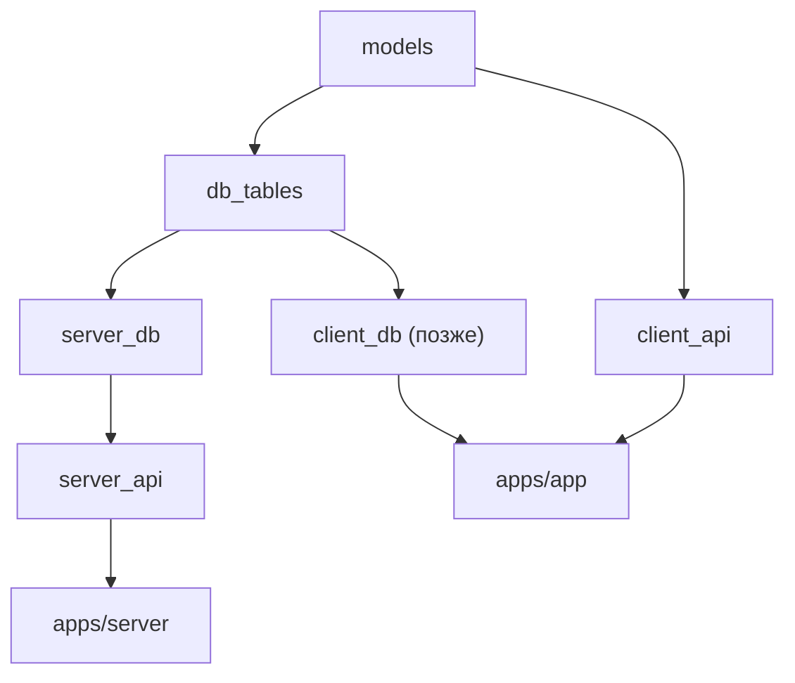
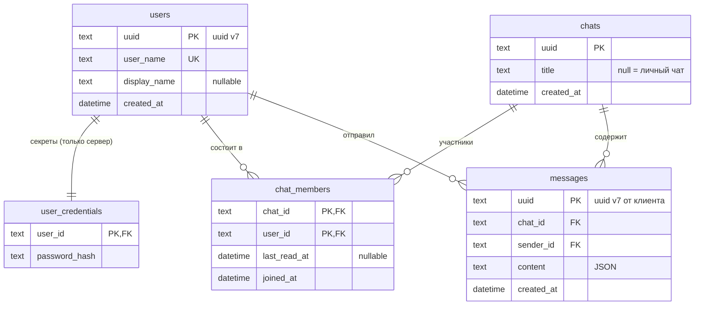

# Messenger: архитектура проекта

Мессенджер на Flutter/Dart: монорепозиторий на Melos, сервер на Dart, обмен событиями через MQTT.

Цель MVP: до 50 пользователей, личные чаты и группы, текстовые сообщения, реалтайм.

---

## Содержание

1. [Стек](#1-стек)
2. [Структура репозитория](#2-структура-репозитория)
3. [Пакеты](#3-пакеты)
4. [Зависимости между пакетами](#4-зависимости-между-пакетами)
5. [Слои и поток данных](#5-слои-и-поток-данных)
6. [Схема базы данных](#6-схема-базы-данных)
7. [Модели](#7-модели)
8. [Контракт MQTT](#8-контракт-mqtt)
9. [Безопасность](#9-безопасность)
10. [Соглашения](#10-соглашения)
11. [Кодогенерация](#11-кодогенерация)
12. [Команды](#12-команды)
13. [План разработки](#13-план-разработки)
14. [Дальнейшее развитие](#14-дальнейшее-развитие)
15. [Принятые решения](#15-принятые-решения)

---

## 1. Стек

| Область | Технология |
|---|---|
| Монорепозиторий | Melos 7 + Dart pub workspaces (Dart ≥ 3.6) |
| Модели | `freezed`, `json_serializable` |
| Идентификаторы | `uuid` (v7) |
| База данных | `drift`: SQLite для разработки и тестов, PostgreSQL (`drift_postgres`) в продакшене |
| Сервер | Dart: `shelf` (HTTP), `mqtt_client` (MQTT) |
| Пароли и вход | `bcrypt`, JWT |
| Реалтайм | MQTT-брокер (Mosquitto / EMQX) поверх TLS |
| Клиент | Flutter, `dio`, `mqtt_client` |

---

## 2. Структура репозитория

```
my_workspace/
├── pubspec.yaml            ← корень: workspace + настройки melos
├── analysis_options.yaml   ← общие правила линтера
├── packages/
│   ├── models/             ← модели, DTO, контракт MQTT (общее для всех)
│   ├── db_tables/          ← описания таблиц drift (общее для баз)
│   ├── server_db/          ← база сервера + репозитории
│   ├── server_api/         ← сервисы с правилами + обработчики HTTP/MQTT
│   ├── client_api/         ← подключение к серверу + репозитории клиента
│   └── client_db/          ← локальный кэш клиента (позже)
└── apps/
    ├── server/             ← запуск сервера (main)
    └── app/                ← Flutter-приложение
```

---

## 3. Пакеты

| Пакет | Назначение | Зависит от |
|---|---|---|
| **models** | Freezed-модели (`User`, `Chat`, `ChatMember`, `Message`, `ChatListItem`), DTO для входа (`LoginRequest`, `RegisterRequest`, `AuthResponse`), контракт MQTT (`Topics`, `ClientAction`, `ServerEvent`). Две точки входа: `models.dart` (для всех) и `server.dart` (только для сервера) | `freezed_annotation`, `json_annotation`, `uuid` |
| **db_tables** | Описания таблиц drift с `@UseRowClass`. Сам код не генерирует | `drift`, `models` |
| **server_db** | `ServerDatabase`, секретная таблица `UserCredentials`, репозитории `UserRepository`, `ChatRepository`, `MessageRepository`. Только чтение и запись, без правил | `db_tables`, `models`, `drift`, `sqlite3` |
| **server_api** | Сервисы с правилами (`AuthService`, `ChatService`, `MessageService`), обработчики MQTT (действия пользователей) и HTTP (регистрация, вход, история) | `server_db`, `models`, `shelf`, `mqtt_client`, `bcrypt`, JWT |
| **client_api** | HTTP-клиент (`dio`) и MQTT-клиент, репозитории клиента: `AuthRepository`, `ChatRepository`, `MessageRepository` | `models`, `dio`, `mqtt_client` |
| **client_db** | `ClientDatabase` для офлайн-кэша. Делается в последнюю очередь | `db_tables`, `models`, `drift` |

| Приложение | Назначение | Зависит от |
|---|---|---|
| **apps/server** | Только `main()`: открыть БД, создать репозитории и сервисы, подключиться к брокеру, запустить HTTP | `server_api`, `server_db` |
| **apps/app** | Экраны и состояние UI | `client_api`, `models` (позже `client_db`) |

---

## 4. Зависимости между пакетами



**Правила:**

- Зависимости идут только в одну сторону: пакет не знает о тех, кто его использует. Например, `server_db` ничего не знает о `server_api`.
- Клиентская часть не зависит ни от одного пакета `server_*`. Поэтому серверный код и секреты физически не могут попасть в приложение.
- Клиент импортирует только `package:models/models.dart`, а не `server.dart`.

---

## 5. Слои и поток данных

```
┌──────────── Клиент ────────────┐                 ┌──────────── Сервер ────────────┐
│ Экран                          │                 │ Обработчик HTTP / MQTT         │
│   ▼                            │   HTTP / MQTT   │   ▼                            │
│ Репозиторий клиента ───────────┼────────────────►│ Сервис (правила и права)       │
│ (client_api)                   │                 │   ▼                            │
│   ▼                            │                 │ Репозиторий сервера (SQL)      │
│ Кэш (client_db, позже)         │                 │   ▼                            │
└────────────────────────────────┘                 │ База данных                    │
                                                   └────────────────────────────────┘
```

| Слой | Где | Что делает |
|---|---|---|
| Экран | `apps/app` | Показывает данные, вызывает репозиторий клиента |
| Репозиторий клиента | `client_api` | Ходит на сервер, позже работает и с кэшем. Прав не проверяет |
| Обработчик | `server_api` | Разбирает запрос, определяет пользователя, вызывает сервис |
| Сервис | `server_api` | Проверяет правила: «участник ли чата», «своё ли сообщение» |
| Репозиторий сервера | `server_db` | Только читает и пишет в базу |

**Транспорт:**

- **HTTP**: регистрация, вход (получение токена), загрузка истории.
- **MQTT**: отправка действий и получение событий в реальном времени.

---

## 6. Схема базы данных

### Таблицы MVP



| Таблица | Где | Описание |
|---|---|---|
| `users` | `db_tables` | Публичный профиль |
| `user_credentials` | **только `server_db`** | Хеш пароля, связь 1:1 с `users` |
| `chats` | `db_tables` | Чат или группа |
| `chat_members` | `db_tables` | Участники и отметка о прочтении |
| `messages` | `db_tables` | Сообщения, содержимое хранится одним JSON |

### Ключевые приёмы

- **Содержимое сообщения одним JSON** (`content`). Новые типы сообщений (фото, ответы, стикеры) добавляются в модель без миграций БД.
- **Непрочитанные считаются запросом**, без хранимых счётчиков: сообщения чата, где `created_at > last_read_at` и отправитель не я.
- **Идентификаторы** хранятся как текст, JSON тоже как текст, поэтому схема одинаково работает в SQLite и PostgreSQL.
- **Внешние ключи** в SQLite включаются вручную: `PRAGMA foreign_keys = ON`.

### Связь таблиц и моделей

Таблицы в `db_tables` используют модели Freezed как классы строк:

```dart
@UseRowClass(User, generateInsertable: true)
class Users extends Table {
  TextColumn get uuid => text()();
  TextColumn get userName => text().unique()();
  TextColumn get displayName => text().nullable()();
  DateTimeColumn get createdAt => dateTime()();

  @override
  Set<Column> get primaryKey => {uuid};
}
```

Drift сверяет поля модели с колонками при генерации кода в `server_db` / `client_db`. Если модель и таблица расходятся, `build_runner` завершится с ошибкой.

У секретной таблицы `UserCredentials` модели нет, drift генерирует для неё собственный класс (`@DataClassName('UserCredentialsRow')`).

---

## 7. Модели

### Пакет `models`

```
packages/models/lib/
├── models.dart          ← для клиента и сервера
├── server.dart          ← для сервера: models.dart + серверные модели
└── src/
    ├── shared/          ← User, Chat, ChatMember, Message, ChatListItem
    ├── dto/             ← LoginRequest, RegisterRequest, AuthResponse, ErrorResponse
    ├── mqtt/            ← Topics, ClientAction, ServerEvent
    └── server/          ← UserRecord (без toJson)
```

| Модель | Поля | Примечание |
|---|---|---|
| `User` | `uuid`, `userName`, `displayName?`, `createdAt` | Без пароля |
| `Chat` | `uuid`, `title?`, `createdAt` | `title == null` означает личный чат |
| `ChatMember` | `chatId`, `userId`, `lastReadAt?`, `joinedAt` | |
| `Message` | `uuid`, `chatId`, `senderId`, `content`, `createdAt` | Фабрика `Message.create()` генерирует uuid v7 |
| `ChatListItem` | `chat`, `lastMessage?`, `unreadCount` | Элемент списка чатов |

### Правила для моделей

- Модели содержат только данные: поля, `copyWith`, `fromJson`/`toJson`. Сетевые вызовы и работа с БД находятся в репозиториях.
- Серверные модели не генерируют `toJson`, поэтому их нельзя случайно отправить клиенту.
- В серверных моделях нет тяжёлых зависимостей (`bcrypt`, БД, JWT).

---

## 8. Контракт MQTT

Топики и формат сообщений описаны в `models`, чтобы клиент и сервер использовали одни и те же классы.

| Топик | Направление | Содержимое |
|---|---|---|
| `server/in/{userId}` | клиент → сервер | `ClientAction` |
| `user/{userId}/events` | сервер → клиент | `ServerEvent` |

```dart
abstract final class Topics {
  static String userActions(String userId) => 'server/in/$userId';
  static String userEvents(String userId) => 'user/$userId/events';
}
```

`ClientAction` и `ServerEvent` — sealed-классы Freezed с полем `type` в JSON:

| `ClientAction` | `ServerEvent` |
|---|---|
| `sendMessage` (uuid, chatId, content) | `newMessage` |
| `deleteMessage` (messageId) | `messageDeleted` |
| `markRead` (chatId) | `readHistory` |

**Отправитель определяется по топику.** ACL брокера разрешает пользователю публиковать только в `server/in/{свой userId}` и читать только `user/{свой userId}/events`.

---

## 9. Безопасность

| Правило | Почему |
|---|---|
| Пароль передаётся только по TLS и только в регистрации и входе | Защита от перехвата |
| Хеш пароля (bcrypt) хранится в `user_credentials` и никогда не покидает сервер | Утечка хеша позволяет подбирать пароль офлайн |
| Пароль хешируется **на сервере**, а не на клиенте | Иначе хеш становится паролем |
| Одинаковая ошибка для «нет пользователя» и «неверный пароль» | Нельзя перебором узнать существующие логины |
| `userId` сервер берёт из JWT (HTTP) или из имени топика (MQTT), а не из тела запроса | Нельзя действовать от чужого имени |
| Права проверяются в сервисах на сервере | Проверку в приложении можно обойти |
| `senderId` и `createdAt` сообщения задаёт сервер | Защита от подделки |
| MQTT только через `mqtts://` (8883) или `wss://` (443), анонимный доступ выключен, настроен ACL | Иначе любой может читать все топики |
| Публичные SQL-запросы перечисляют колонки явно | Секретные поля не попадут в ответ случайно |
| Пароли, ключи и адреса БД передаются через переменные окружения | Не храним секреты в коде |
| В Flutter-приложении нет ни одного пакета `server_*` | Серверный код не попадает в сборку |

---

## 10. Соглашения

- **Идентификаторы**: uuid v7. Для сообщений id генерирует клиент, поэтому повторная отправка после обрыва связи не создаёт дубль (`ON CONFLICT DO NOTHING`).
- **Время**: всегда UTC (`DateTime.now().toUtc()`, в PostgreSQL `timestamptz`). В локальное время переводится только при отображении.
- **Порядок сообщений**: по серверному `created_at`, затем по `uuid`.
- **Имена**: в Dart `camelCase`, в БД `snake_case` (drift переводит автоматически).
- **Генерируемые файлы** лежат в папках `generated/` рядом с исходниками.
- **Импорт из `src/` другого пакета запрещён** (`implementation_imports: error`).

---

## 11. Кодогенерация

`build.yaml` в каждом пакете с генерацией (`models`, `server_db`, `client_db`):

```yaml
targets:
  $default:
    builders:
      freezed:
        options:
          build_extensions:
            '^lib/{{path}}/{{file}}.dart': 'lib/{{path}}/generated/{{file}}.freezed.dart'
      source_gen:combining_builder:
        options:
          build_extensions:
            '^lib/{{path}}/{{file}}.dart': 'lib/{{path}}/generated/{{file}}.g.dart'
      drift_dev:                                  # только в пакетах баз
        options:
          store_date_time_values_as_text: true
```

В исходниках:

```dart
part 'generated/user.freezed.dart';
part 'generated/user.g.dart';
```

Файлы моделей и баз должны лежать хотя бы в одной папке внутри `lib/` (например, `lib/src/...`), иначе правило с `{{path}}` не сработает.

`analysis_options.yaml` в корне:

```yaml
analyzer:
  exclude:
    - "**/*.g.dart"
    - "**/*.freezed.dart"
  errors:
    implementation_imports: error
```

---

## 12. Команды

```bash
# первый запуск
dart pub global activate melos
dart pub get
melos bootstrap

# разработка
melos run gen        # кодогенерация во всех пакетах
melos run analyze    # анализ кода
melos run test       # тесты
melos run check:imports
```

Скрипты в корневом `pubspec.yaml`:

```yaml
melos:
  scripts:
    gen:
      run: dart run build_runner build -d
      exec:
        concurrency: 1
      packageFilters:
        dependsOn: build_runner

    analyze:
      run: dart analyze .
      exec:
        concurrency: 5

    test:
      run: dart test
      exec:
        concurrency: 1
      packageFilters:
        dirExists: test

    check:imports:
      description: Приложение не должно импортировать серверные модели
      run: |
        if grep -rn "package:models/server.dart" apps/app/lib; then
          echo "❌ apps/app импортирует серверные модели"; exit 1
        fi
        echo "✅ ok"
```

Новый пакет:

1. `dart create -t package packages/<имя>`
2. В его `pubspec.yaml` добавить `resolution: workspace` и зависимости.
3. Добавить путь в `workspace:` корневого `pubspec.yaml`.
4. Скопировать `build.yaml`, если в пакете есть генерация.
5. `melos bootstrap`.

---

## 13. План разработки

Работа идёт по одной функции за раз через все слои. Каждый шаг проверяется отдельно.

| # | Шаг | Пакет | Проверка | Статус |
|---|---|---|---|---|
| 1 | Модели | `models` | Генерация проходит | ✅ |
| 2 | Таблицы и база сервера, репозитории | `db_tables`, `server_db` | Генерация (сверка с моделями), тесты на SQLite в памяти | ⬜ |
| 3 | Контракт MQTT | `models` | Тест «toJson → fromJson даёт тот же объект» | ⬜ |
| 4 | Сервисы и обработчики | `server_api` | Тесты сервисов | ⬜ |
| 5 | Запуск сервера | `apps/server` | curl для HTTP, MQTT Explorer / `mosquitto_pub` для MQTT | ⬜ |
| 6 | Клиентские репозитории | `client_api` | Консольная программа против живого сервера | ⬜ |
| 7 | Интерфейс | `apps/app` | Ручная проверка, тестеры | ⬜ |
| 8 | Офлайн-кэш | `client_db` | Тесты, работа без сети | ⬜ |

### Тесты базы

- Таблицы создаются (проверка `sqlite_master`).
- Каждая модель сохраняется и читается без потерь: `expect(loaded, original)`.
- Внешние ключи отклоняют записи с несуществующими ссылками.
- Даты в тестах задаются через `DateTime.utc(...)`.

### Минимальный набор функций MVP

- Регистрация и вход.
- Список чатов с последним сообщением и числом непрочитанных.
- Создание личного чата и группы, поиск пользователей.
- Отправка и получение текстовых сообщений в реальном времени.
- История с подгрузкой.
- Отметка о прочтении.

---

## 14. Дальнейшее развитие

| Функция | Изменения |
|---|---|
| Редактирование и удаление | Колонки `edited_at`, `deleted_at` + поля в модели `Message` |
| Ответы, медиа, форматирование | Только модель содержимого (`content`), без миграции БД |
| Файлы | Таблица `files` (id, owner_id, storage_key, size), хранилище S3 |
| Реакции | Таблица `reactions` (message_id, user_id, emoji) |
| Push-уведомления | Таблица `devices`, FCM/APNs (на iOS без push не обойтись) |
| Роли в группах | Колонка `role` в `chat_members` |
| Надёжная синхронизация | `seq` в сообщениях, журнал событий `updates` |
| PostgreSQL | Замена `NativeDatabase` на `PgDatabase` (`drift_postgres`) |
| E2E-шифрование | Таблицы ключей, шифротекст в `content`. Лучше взять готовый протокол (MLS / Matrix) |
| Боты | `users.is_bot`, таблица `bots`, Bot API |

При изменении схемы: поднять `schemaVersion` и написать миграцию. Пока база тестовая, её можно просто пересоздать.

---

## 15. Принятые решения

| Решение | Причина |
|---|---|
| Монорепозиторий на Melos | Общие модели для клиента и сервера, единые скрипты |
| Сервер на Dart | Общие Freezed-модели и контракт без дублирования |
| uuid v7, генерируемый клиентом | Защита от дублей, сортировка по времени, мгновенный показ сообщения в UI |
| Содержимое сообщения одним JSON | Новые типы сообщений без миграций |
| Таблица участников вместо списка в чате | Отметки о прочтении, роли |
| Хеш пароля в отдельной таблице | Нельзя случайно выбрать его вместе с профилем |
| `@UseRowClass` вместо отдельных классов строк | Модели остаются главными, drift проверяет соответствие таблиц |
| Таблицы общие, базы раздельные | Разный состав данных и независимые миграции клиента и сервера |
| HTTP для входа и истории, MQTT для событий | Вход нужен до подключения к брокеру; история — это запрос-ответ |
| SQLite сейчас, PostgreSQL потом | Быстрый старт и тесты без инфраструктуры |
| Без E2E в MVP | Самая сложная часть; для MVP достаточно TLS |